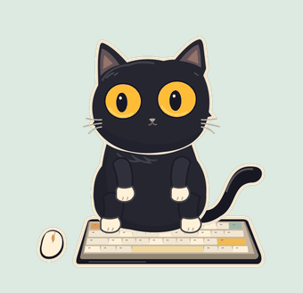

# 墨爪 · Soot Keys

墨爪是一只在奶油色小键盘后面蹲班的黑猫。它用前爪打字，左后脚踩空格，右后脚够回车。敲快了，四只白袜子一起上。



[下载 Windows 便携包](https://github.com/sandao-yiye/soot-keys/releases/latest/download/SootKeys-Windows.zip) · [查看版本记录](https://github.com/sandao-yiye/soot-keys/releases)

## 在 Codex 里启动墨爪（Windows 10/11）

1. 下载并解压发布包，双击 **Install-CodexPet.cmd**。从 v1.0 升级也要执行这一步。
2. 打开 Codex 的 **设置 → 智能伙伴 → 选择智能伙伴**，点 **墨爪**。部分界面的入口叫「迷你界面和智能伙伴」。如果已经打开过列表、暂时没看到新猫，完全退出后重新打开 Codex。
3. 打开桌面伙伴，墨爪便会跟着键盘和鼠标动作。切换到其他伙伴或收起 Codex 桌宠时，互动窗口会随之收起。

安装器会把图集装进 `~/.codex/pets/soot-keys/`（支持自定义 `CODEX_HOME`），把互动程序复制到当前用户的 `%LOCALAPPDATA%\SootKeys\bridge`，并在 Windows 启动文件夹里创建快捷方式。联动程序会在安装后启动，以后登录 Windows 时自动就绪。它读取 Codex 记录的伙伴选择和打开状态；只有显示互动桌宠时才注册键鼠输入。双击 **Remove-CodexLink.cmd** 可移除联动和登录启动项，保留原生图集与自己的设置。

联动适配 Windows 版 OpenAI.Codex 安装包，本次核对版本为 26.1120.6357.0。识别到原生「墨爪」图像的位置时，程序会临时遮去这块图像，让互动猫接手。若当前客户端未暴露对应的辅助功能信息，原生图像可能与互动猫同时显示。其他平台可将 `pet` 文件夹以 `soot-keys` 为名放入 Codex 的 `pets` 目录，使用原生图集。

## 让它跟着你敲键盘

也可以直接双击 **SootKeys.exe** 单独玩。

| 你的动作 | 墨爪的动作 |
| --- | --- |
| 敲键盘左区或右区 | 伸出对应的前爪拍键，另一只爪子收起来 |
| 按空格 | 抬起前爪，用左后脚斜着踩空格 |
| 按回车 | 右后脚够到回车，顺便挤一下眼睛 |
| 快速连打 | 四爪抢着敲，回车键帽被弹飞，歪扣在两只耳朵中间，再翻回键盘 |
| 移动指针 | 金色眼睛一路追视，偶尔来个双连眨 |
| 点鼠标左键 | 向左侧探身，用白爪去够它自己的小鼠标 |

## 右键与百宝箱

在互动猫身上或托盘图标上右击，进入 **调整大小**。小巧、标准、大、超大、巨型五档即时生效，在 100% 显示缩放下画布宽度分别为 162、192、220、249、278 像素。猫以脚底为基准缩放，下次启动会记住大小。拖动可摆放位置，**回到初始位置** 可把它带回当前屏幕。菜单也可以切换整只猫跟随、暂停键鼠互动、点播动作或让猫说句碎碎念。

**墨爪百宝箱** 里的内容都可以离线玩。

| 入口 | 可以做什么 |
| --- | --- |
| 动作 | 搜索动作，点播、收藏，查看最近玩过的动作 |
| 小剧场 | 五个三幕小故事，可以暂停、继续或跳到下一幕 |
| 专注 | 15、25、45 分钟快捷计时，也可设为 5–120 分钟；记录当天完成的轮数，重新启动后可继续上次未完成的倒计时 |
| 接泡泡 | 30 秒内接泡泡，挑战当天最佳成绩 |
| 抽签 | 抽一张墨爪的小签，可以收藏和重温 |

设置和百宝箱记录保存在当前用户的 `%LOCALAPPDATA%\SootKeys`。互动程序使用 Windows Raw Input 把敲击归为动作，不保存输入文本。

## 从源码构建

仓库包含可编辑的角色绘图、动作编排、逐帧素材、Codex 图集及 Windows 程序源码。已有帧可直接构建，Windows 端使用 .NET Framework 4.8 和 Windows PowerShell。

```powershell
# 编译便携程序到 desktop/dist/SootKeys.exe
.\desktop\build.ps1

# 自检并生成 dist/SootKeys-Windows.zip
.\Package-Windows.ps1
```

要改角色外观，编辑 `art/illustration.py`。要改姿势和动作幅度，编辑 `art/motion.py`，然后重新生成素材，再构建程序。

```sh
python -m pip install Pillow aggdraw
python art/build.py
```

代码和项目原创美术采用 [MIT 许可证](LICENSE)。
